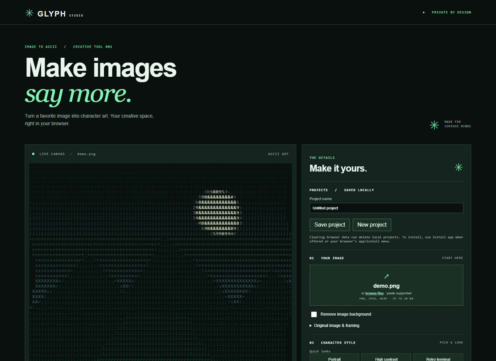

<div align="center">

# ✳️ GLYPH Studio

**Turn images into ASCII art, visual effects, and animations, right in your browser.**

<a href="https://glyph-studio-vercel.vercel.app/"></a>


[Development status](DEVELOPMENT_STATUS.md) · [Security and performance](docs/security-and-performance.md) · [Contributing](CONTRIBUTING.md) · [Security policy](SECURITY.md)

</div>

---

## 🎬 Demo

Try it live: **[glyph-studio-vercel.vercel.app](https://glyph-studio-vercel.vercel.app/)**. Drop an image on the homepage to preview every effect, or open ASCII and choose **Try demo**.

<p align="center">
  
</p>

<p align="center">
  
</p>

> GLYPH Studio is a local-first creative app under active development. Created and produced by [Muhammad Qaid Uqail (@qaid-u)](https://github.com/qaid-u). The name is a working name; no trademark registration or clearance is claimed.

## ✨ Features

- **ASCII studio:** convert PNG, JPEG, and WebP images into character art; adjust character style, colors, framing, and image settings.
- **Motion:** preview wave, glitch, matrix rain, dissolve, pulse, and ripple animations with playback and timeline controls.
- **Image effects:** One Bit Dither, Pink Phosphor, CRT, Flash Light, Receipt Ticket, Datamosh, and Blob Tracking, each with presets, optional detailed controls, rotation, horizontal flip, and PNG export. Animated converters can also export WebM in supported browsers.
- **Background removal:** on-device subject detection, simple edge-color removal, and mask refinement for all converters. PNG exports keep transparency; the receipt converter keeps its paper background; WebM uses a dark backdrop.
- **Exports:** the ASCII studio supports PNG, TXT, animated GIF (max 640 px on the longest edge), and WebM (browser-dependent).
- **Private by design:** images are processed on your device and never uploaded; no account or backend required.
- **Mobile and offline:** mobile editor shortcuts and an installable PWA. After the app shell is cached, core features work offline; run subject detection once online to cache its model and runtime.

Detailed controls include stochastic dithering, phosphor ghosting and scanlines, CRT screen roll, flashlight beam shape, receipt paper and print settings, datamosh block opacity, and blob overlay options. **Reset edits** restores defaults without removing the image. Datamosh is a simulated effect, and Blob Tracking detects regions in a still image rather than tracking real-world motion.

## 🧰 Tech stack

| Area | Tools |
| --- | --- |
| UI | React 19, TypeScript, Vite |
| Rendering | Canvas 2D (shared render path for previews and exports) |
| Subject detection | ONNX Runtime Web in a Web Worker with bundled U²-Net weights |
| Export | `gifenc` for GIF, MediaRecorder for WebM, canvas for PNG |
| PWA | `vite-plugin-pwa` service worker |
| Testing | Vitest, Playwright |
| Hosting | Vercel (security headers and firewall protections) |

ASCII conversion samples image pixels, maps luminance to characters, and renders a grid.

## 🚀 Quick start

Requirements: **Node.js 24**, npm, and an installed Microsoft Edge browser for the default browser tests. The repository is private, so cloning requires access.

```bash
git clone https://github.com/qaid-u/GLYPH-Studio-ASCII-Art-Motion-Creator.git
cd GLYPH-Studio-ASCII-Art-Motion-Creator
npm ci
npm run dev
```

Open the local address printed by Vite.

| Command | Purpose |
| --- | --- |
| `npm run dev` | Start the development server |
| `npm run lint` | Lint application and browser-test code |
| `npm run typecheck` | Check TypeScript types |
| `npm test` | Run engine unit tests |
| `node --test tests/firewall-monitor.test.mjs` | Test the optional firewall-monitor logic |
| `npm run build` | Type-check and create a production build in `dist/` |
| `npm run test:browser` | Run browser interaction and export tests |
| `npm run test:offline` | Test the built PWA's offline and security behavior (build first) |

Set `GLYPH_BROWSER_CHANNEL` to use another installed Playwright browser channel. Browser tests need permission to launch a browser and connect to a local server.

## 🗂️ Project structure

```
src/        Application and engine code (with unit tests)
public/     Static assets and illustrations
tests/      Browser and offline/PWA tests
scripts/    Build and support scripts
docs/       Preview images, security and performance notes
vercel.json Deployment headers and configuration
```

## 🔒 Limitations and security

GLYPH Studio is a **working prototype**, not a finished production release. Subject detection is probabilistic, and mask refinement requires pointer or touch input. Mobile behavior, accessibility, offline installation, and exports need broader testing across devices and browsers. Project-saving controls are not currently available; project data from earlier versions remains in the browser until removed.

The service worker caches the app shell; the subject-detection model and WebAssembly runtime are cached after first use, which requires a connection. The deployed app uses security headers and Vercel firewall protections, but browser-delivered code and public assets can still be inspected or copied. Optional Telegram firewall notifications require separate setup and are **disabled until configured and tested**; see [Security and performance](docs/security-and-performance.md).

## 📄 Documentation and license

- [Development status](DEVELOPMENT_STATUS.md): completed work, verification, and next steps
- [Contributing guide](CONTRIBUTING.md): setup and expectations for authorized collaborators
- [Security policy](SECURITY.md): how to report a suspected issue
- [Third-party notices](THIRD_PARTY_NOTICES.md): dependency and model attribution
- [Product blueprint](development.md): longer-term development notes
- [Proprietary rights notice](license.md): draft for owner review

Copyright © 2026 Muhammad Qaid Uqail. All rights reserved. Third-party components remain subject to their respective licenses.
