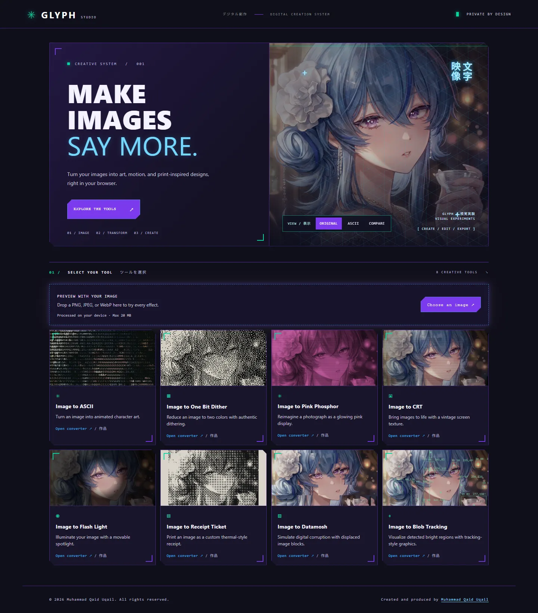

# GLYPH Studio

**Turn images into ASCII art, visual effects, and animations in your browser.**

[Open GLYPH Studio](https://glyph-studio-vercel.vercel.app/) · [Development status](DEVELOPMENT_STATUS.md) · [Security and performance](docs/security-and-performance.md)

Created and produced by [Muhammad Qaid Uqail (@qaid-u)](https://github.com/qaid-u). GLYPH Studio is a working name; no trademark registration or clearance is claimed.



GLYPH Studio is a local-first creative application under active development. Choose an image, compare effects, adjust the result, and export your artwork. The app runs in the browser without an account or a backend.

## Features

- **ASCII studio:** Convert PNG, JPEG, and WebP images into character art. Adjust the character style, colors, framing, and image settings.
- **Motion:** Preview wave, glitch, matrix rain, dissolve, pulse, and ripple animations with playback and timeline controls.
- **Image effects:** Explore One Bit Dither, Pink Phosphor, CRT, Flash Light, Receipt Ticket, Datamosh, and Blob Tracking. Each converter has presets, optional detailed controls, image rotation and horizontal flip, and PNG export. Animated converters can also export WebM in supported browsers.
- **Background removal:** All converters support on-device subject detection, simple edge-color removal, and mask refinement. PNG exports retain transparency; the receipt converter keeps its paper background, and WebM uses a dark backdrop.
- **Exports:** The ASCII studio supports PNG, TXT, animated GIF, and WebM. GIF output is limited to 640 pixels on its longest edge; WebM support varies by browser.
- **Mobile and offline:** Use the mobile editor shortcuts and install the PWA where supported. After the app shell is cached, core features can work offline. Run subject detection once online to cache its model and runtime for subsequent offline use.

The detailed controls include stochastic dithering, phosphor ghosting and scanlines, CRT screen roll, flashlight beam shape, receipt paper and print settings, datamosh block opacity, and blob overlay options. Find these controls directly in the converter’s adjustment panel; **Reset edits** restores its defaults without removing the image.

Datamosh is a simulated visual effect. Blob Tracking detects regions in a still image rather than tracking real-world motion. See [DEVELOPMENT_STATUS.md](DEVELOPMENT_STATUS.md) for tested behavior and current work.

## Get started

1. Open the [live app](https://glyph-studio-vercel.vercel.app/).
2. Drop or choose an image on the homepage to preview the effects, or open ASCII and choose **Try demo**.
3. Pick a converter, adjust its settings, and download the result.

Your image is processed on your device; the app does not upload it to a server. Project-saving controls are not currently available. Any project data from earlier versions remains in the browser until you remove it.

## Run locally

Requirements: **Node.js 24**, npm, and an installed Microsoft Edge browser for the default browser tests.

```bash
git clone https://github.com/qaid-u/GLYPH-Studio-ASCII-Art-Motion-Creator.git
cd GLYPH-Studio-ASCII-Art-Motion-Creator
npm ci
npm run dev
```

Open the local address printed by Vite. The repository is private, so cloning requires access.

## Development checks

| Command | Purpose |
| --- | --- |
| `npm run dev` | Start the development server |
| `npm run lint` | Lint application and browser-test code |
| `npm run typecheck` | Check TypeScript types |
| `npm test` | Run engine unit tests |
| `node --test tests/firewall-monitor.test.mjs` | Test the optional firewall-monitor logic |
| `npm run build` | Type-check and create a production build in `dist/` |
| `npm run test:browser` | Run browser interaction and export tests |
| `npm run test:offline` | Test the built PWA's offline and security behavior; run the build first |

Set `GLYPH_BROWSER_CHANNEL` to use another installed Playwright browser channel. Browser tests need permission to launch a browser and connect to a local server.

## How it works

The app uses React, TypeScript, Vite, and Canvas 2D. ASCII conversion samples image pixels, maps luminance to characters, and renders a grid. Procedural effects use the same render path for previews and supported exports. Subject detection runs locally in a Web Worker using ONNX Runtime Web and bundled U²-Net weights.

The service worker caches the application shell. The subject-detection model and WebAssembly runtime are cached after their first use; the first use requires a connection. No user image is sent to the server by the application.

## Limitations and security

GLYPH Studio is a **working prototype**, not a finished production release. Subject detection is probabilistic, and mask refinement requires pointer or touch input. Mobile behavior, accessibility, offline installation, and exports need broader testing across devices and browsers.

The deployed app uses security headers and Vercel firewall protections. Browser-delivered code and public assets can still be inspected or copied. Optional Telegram firewall notifications require separate setup and are **disabled until configured and tested**. See [Security and performance](docs/security-and-performance.md) for the alert scope and setup instructions.

## Project documentation

- [Development status](DEVELOPMENT_STATUS.md) — completed work, verification, and next steps
- [Contributing guide](CONTRIBUTING.md) — setup and expectations for authorized collaborators
- [Security policy](SECURITY.md) — how to report a suspected issue
- [Third-party notices](THIRD_PARTY_NOTICES.md) — dependency and model attribution
- [Product blueprint](development.md) — longer-term development notes
- [Proprietary rights notice](license.md) — draft for owner review

## Link Website
https://glyph-studio-vercel.vercel.app/

Copyright © 2026 Muhammad Qaid Uqail. All rights reserved. Third-party components remain subject to their respective licenses.
